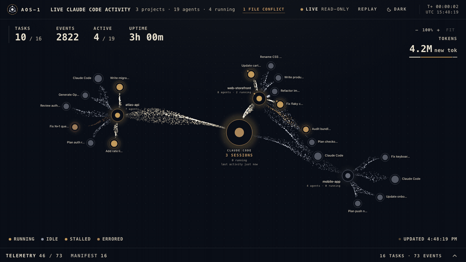

# AOS Dashboard

A live, read-only view of your Claude Code sessions: agents, tasks, tokens, cost, file conflicts and alerts, as a streaming graph in the browser, a terminal view (`aos-dash`), an MCP server and a status line. Local-only, zero dependencies.

It also shows [AOS-1](https://github.com/tomtomsatnav/aos-1-spec) goals, a small open standard for observable agent orchestration (periodic heartbeat, plain-file state, append-only event log). The spec lives in [aos-1-spec](https://github.com/tomtomsatnav/aos-1-spec); the experimental orchestrator engine lives in [aos-orchestrator](https://github.com/tomtomsatnav/aos-orchestrator).

<p align="center">
  <a href="docs/screenshots.md"></a><br>
  <sub>The live dashboard on a synthetic demo dataset. <a href="docs/screenshots.md">More screenshots</a>.</sub>
</p>

## Install the dashboard

Needs Node 18+ and the Claude Code CLI. No dependencies to install.

```sh
make install        # builds, installs the local plugin, links `aos-dash`, starts the monitor
make doctor         # checks the whole setup and tells you what to fix
make                # lists every target
```

Then start a new Claude Code session and open http://127.0.0.1:4318. The graph's `Streams` button (or `Q`) cycles Full / Quiet / Lines; Lines draws no particles and stops per-frame redraws, for the lowest overhead ([measured](docs/overhead.md)). Local-only, read-only; hooks never log prompts, file contents or tool output, but do log event and tool names, working-folder and edited-file paths, transcript paths and a redacted short task description (full list: [plugin/README.md](plugin/README.md#privacy)). Status: personal project, macOS-first. [MIT License](LICENSE).

## GOALS panel

The GOALS panel shows orchestrator goals from disk, but approving, pausing and starting goals needs the control server from [aos-orchestrator](https://github.com/tomtomsatnav/aos-orchestrator) (`aos-orch serve`, port 4319). Without it the panel is read-only. The files the dashboard reads are described in [docs/orch-state-contract.md](docs/orch-state-contract.md).

## Docs

- [aos-1-spec](https://github.com/tomtomsatnav/aos-1-spec): normative specification, schemas, conformance validator, reference runner
- [aos-orchestrator](https://github.com/tomtomsatnav/aos-orchestrator): orchestrator engine and its design doc
- [docs/dashboard.md](docs/dashboard.md): the Claude Code dashboard, highlights, debugging, security and threat model
- [docs/architecture.md](docs/architecture.md): how events flow from hooks to the UI
- [docs/screenshots.md](docs/screenshots.md): screenshot gallery
- [docs/overhead.md](docs/overhead.md): measured monitor CPU and memory
- [docs/orch-state-contract.md](docs/orch-state-contract.md): the on-disk layout the dashboard reads from an orchestrator
- [plugin/README.md](plugin/README.md): plugin details and the exact privacy field list

## Contributing

Issues and small pull requests are welcome. Edit the sources in the repo root (`monitor.mjs`, `hooks/`, `ui/`, `cli/`), then run `make build` and `make test`; keep it zero-dependency and Node 18 compatible.
