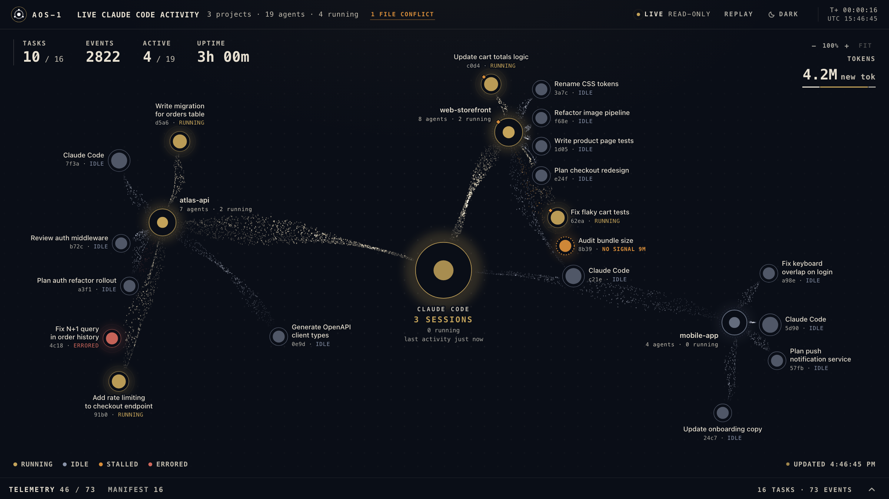
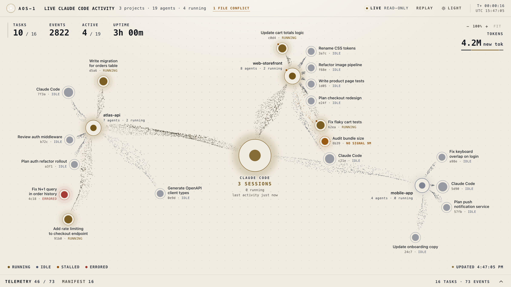
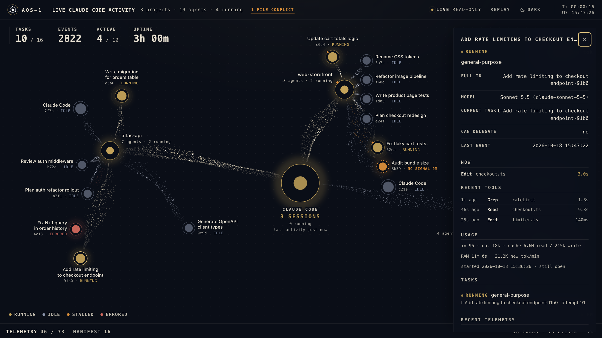
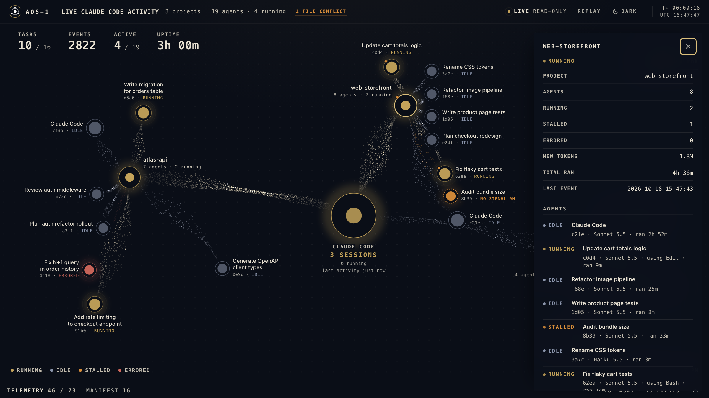
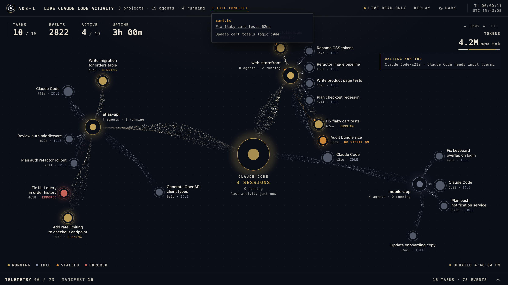
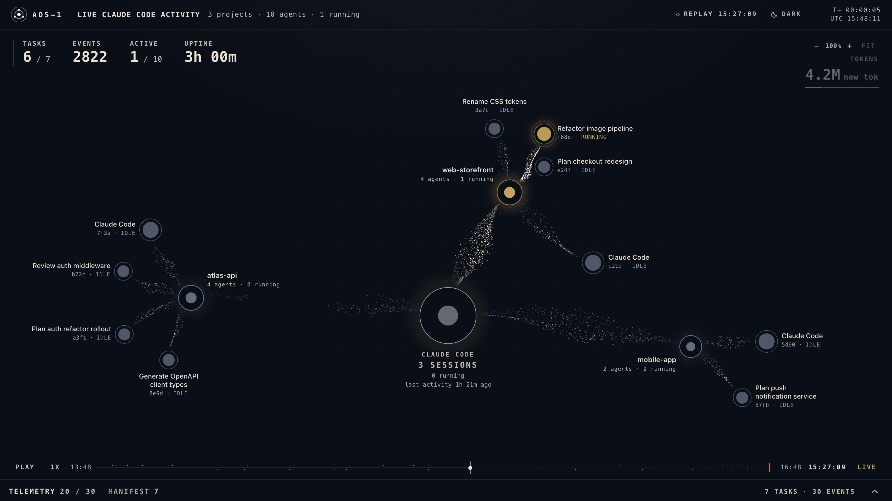
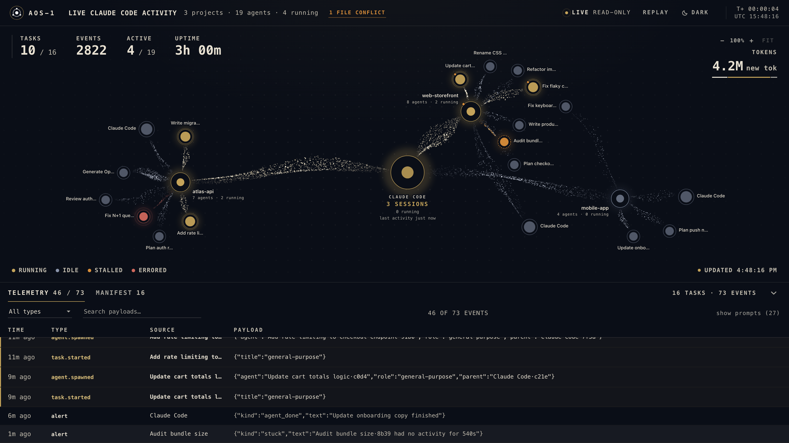
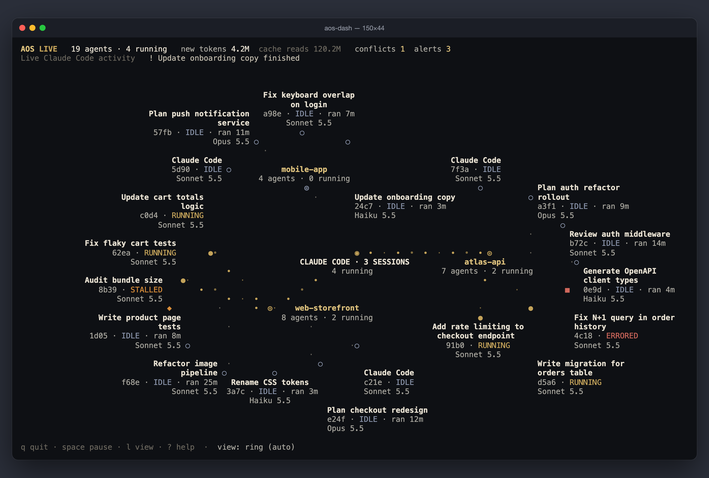

# Screenshots

All screenshots use a synthetic demo dataset (no real projects or paths).

<table>
<tr>
<td> Project graph: heart, project hubs, agents, live streams</td>
<td> Same scene in the light theme</td>
</tr>
<tr>
<td> Agent drawer: current tool, tool feed, tokens, run time, model</td>
<td> Project drawer: every agent in the project</td>
</tr>
<tr>
<td> File conflict popover and an alert toast</td>
<td> Replay: scrub back through the last hours</td>
</tr>
<tr>
<td> Telemetry dock with the event stream</td>
<td> Terminal dashboard (aos-dash)</td>
</tr>
</table>

Regenerate with `make screenshots` (needs playwright-core and the monitor running; ffmpeg for the GIF). The data comes from `scripts/demo-state.mjs`, served to the real UI through request interception.
